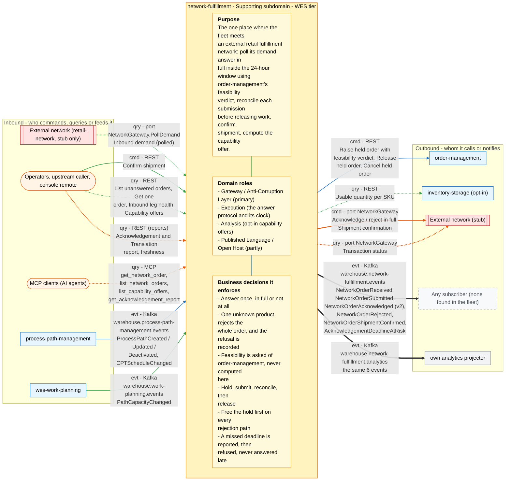

# Bounded Context Canvas

Following the ddd-crew [Bounded Context Canvas v5](https://github.com/ddd-crew/bounded-context-canvas).
Every message row maps to a real route, MCP tool, port call or Kafka topic
in the code on `develop`.

## Canvas at a glance

One picture of the sections below, laid out like the ddd-crew canvas:
inbound collaborators on the left, this context in the middle (purpose,
domain roles and the business decisions it enforces), outbound
collaborators on the right. Arrows follow the message type: **solid blue**
commands (`cmd`), **dotted green** queries (`qry`), **thick orange** events
(`evt`); each arrow names its channel and the messages it carries. Box shapes
mark the collaborator kind: rounded = people, UI or any client; blue =
sibling bounded context; double border = external system or platform;
grey = this context's own projector, reports or dead-letter path; dashed =
published today with no consumer. Channel names on the arrows are
abbreviated (REST, MCP, Kafka, HTTP, port); the Inbound and Outbound
Communication tables carry the exact route, tool, topic and CloudEvents
type for every message.

Source: the Inbound Communication and Outbound Communication tables of this
page, which map to `internal/adapters/inbound/{http,kafka,mcp,poller}` and `internal/adapters/outbound/`. The diagram omits assumptions, verification metrics, open
questions and the ubiquitous language (sections below), the relationship
pattern per message (OHS, ACL, Conformist, Customer/Supplier - see the
tables) and anything the tables mark as deprecated or platform-only
(health probes).

## Name

**Network Fulfillment** (`network-fulfillment`, CloudEvents subdomain `wes`).

## Purpose

To be the one place where the fleet meets an external retail fulfillment
network. Since ADR 0009 the counterpart is the fleet's own `retail-network`
service; the original learning target was a large retailer's Selling Partner
API. The context:

- receives the network's demand by polling;
- answers it inside the network's 24-hour window, acknowledged in full or
  rejected in full, using `order-management`'s feasibility verdict;
- reconciles each asynchronous submission before it releases any work;
- confirms shipment when it is told one happened;
- computes the throughput-constrained quantity it would advertise
  (`CapabilityOffer`).

The network's vocabulary never reaches the rest of the fleet, and no
ship-to PII enters this context at all.

## Strategic Classification

| Axis | Verdict |
| --- | --- |
| **Domain** | **Supporting Subdomain** (ADR 0001). See [core-domain-chart.md](core-domain-chart.md). |
| **Business Model** | Revenue-channel enabler: it lets the building's fulfillment capability be sold through an external network without any other context knowing the network exists. |
| **Evolution** | Custom-built (the ACL and the acknowledgement protocol). `CapabilityOffer` is Genesis → Custom. The counterpart's API is a Product that this context conforms to. |

## Domain Roles

| Role | Applies? | Evidence |
| --- | --- | --- |
| **Gateway / Anti-Corruption Layer** | **Yes, primary** | The network vocabulary stops at `internal/adapters/outbound/network/`. `ports.NetworkGateway` and `contract.*` are expressed in our terms, and `NetworkOrder.SKUQuantities()` is the only shape sent to `order-management`. |
| **Execution (protocol)** | **Yes, narrow** | Owns the answer, the 24h clock (`acknowledgeBy`, the sweep, `RejectOverdueOrders`) and reconciliation. It does not own the fulfillment work, which belongs to `order-management`. |
| **Analysis** | **Yes, opt-in** | `RecomputeCapabilityOffers` derives advertised availability from inventory, the CPT schedule and path capacity (`CAPABILITY_OFFER_ENABLED`). |
| **Published Language / Open Host** | **Partly** | Publishes 6 CloudEvents types on `warehouse.network-fulfillment.events` (documented in `apis/asyncapi.yaml`). No other fleet context was found consuming them. Read-only REST and MCP are exposed for operators and agents. |

## Inbound Communication

| Collaborator | Message | Type | Channel | Relationship |
| --- | --- | --- | --- | --- |
| External network (`retail-network`, stub only) | Inbound demand (`contract.InboundDemand`) | Query (poll) | `ports.NetworkGateway.PollDemand`, driven by `internal/adapters/inbound/poller` | Conformist (we are downstream) |
| Operator / upstream caller | Confirm shipment | Command | REST `POST /network-orders/{networkRef}/shipment-confirmation` (ADR 0014) | Open Host (unauthenticated) |
| Operators, `web/` remote in `warehouse-console` | List unanswered orders | Query | REST `GET /network-orders` | Open Host |
| Operators | Get one order | Query | REST `GET /network-orders/{networkRef}` | Open Host |
| Operators, `web/` remote | Inbound leg health | Query | REST `GET /inbound-status` | Open Host |
| Operators | Capability offers | Query | REST `GET /capability-offers` (only when `CAPABILITY_OFFER_ENABLED=true`) | Open Host |
| Kubernetes / Prometheus | Liveness, readiness, metrics | Query | REST `GET /healthz`, `GET /readyz`, `GET /metrics` | — |
| MCP clients (AI agents) | Get / list network orders | Query | MCP `get_network_order`, `list_network_orders`, resource `network-order://network-fulfillment/{networkRef}` | Open Host (read-only) |
| MCP clients | List capability offers | Query | MCP `list_capability_offers` | Open Host (read-only) |
| MCP clients | Acknowledgement report | Query | MCP `get_acknowledgement_report` (when `REPORTS_BASE_URL` is set) | Open Host (read-only) |
| Report consumers | Acknowledgement & Translation report | Query | REST (`cmd/netfulfil-reports`) `GET /reports/acknowledgement`, `GET /reports/acknowledgement/freshness` | Open Host |
| `process-path-management` | Path catalogue + CPT schedule | Event | Kafka `warehouse.process-path-management.events`: `com.warehouse.wes.process-path-management.processpath.ProcessPathCreated`, `...processpath.ProcessPathUpdated`, `...processpath.ProcessPathDeactivated`, `com.warehouse.wes.process-path-management.cptschedule.CPTScheduleChanged` | Conformist (opt-in cache) |
| `wes-work-planning` | Remaining path capacity | Event | Kafka `warehouse.work-planning.events`: `com.warehouse.wes.work-planning.workpool.PathCapacityChanged` | Conformist (opt-in cache) |
| Itself (analytics projector) | Own events, for the report | Event | Kafka `warehouse.network-fulfillment.analytics`: `...networkorder.NetworkOrderReceived`, `...NetworkOrderSubmitted`, `...NetworkOrderAcknowledged.v2` (and the historic `...NetworkOrderAcknowledged` v1), `...NetworkOrderRejected` | Internal |

## Outbound Communication

| Collaborator | Message | Type | Channel | Relationship |
| --- | --- | --- | --- | --- |
| `order-management` | Raise held order + feasibility verdict | Command | REST `POST /orders` (`releaseOnAllocation: false`, `allowPartialShipment: false`, `requiredShipBy`) | Customer/Supplier (we are the Customer; OM ADR 0020) |
| `order-management` | Release held order | Command | REST `POST /orders/{id}/release` | Customer/Supplier |
| `order-management` | Cancel held order | Command | REST `DELETE /orders/{id}` | Customer/Supplier |
| `inventory-storage` | Usable quantity per SKU | Query | REST `GET /inventory/{sku}/usable` (opt-in) | Conformist to its Open Host |
| External network | Acknowledge / reject in full | Command | `ports.NetworkGateway.SubmitAcknowledgement(ref, accepted)` (stub) | Conformist |
| External network | Transaction status | Query | `ports.NetworkGateway.SubmissionStatus(ref)` (stub) | Conformist |
| External network | Shipment confirmation | Command | `ports.NetworkGateway.SubmitShipmentConfirmation(ref)` (stub) | Conformist |
| External network | Availability, capability declaration, label | Command / Query | `SubmitAvailability`, `DeclareCapability`, `RequestLabel`: **on the port and in the stub, called by no use case** | Conformist (wired, unused) |
| Any subscriber | `NetworkOrderReceived`, `NetworkOrderSubmitted`, `NetworkOrderAcknowledged` (v2, `.v2` type), `NetworkOrderRejected`, `NetworkOrderShipmentConfirmed`, `AcknowledgementDeadlineAtRisk` | Event | Kafka `warehouse.network-fulfillment.events`, type `com.warehouse.wes.network-fulfillment.networkorder.<Event>` (with `EVENT_PUBLISHER=kafka`) | Open Host / Published Language |
| Analytics projector | The same 6 events | Event | Kafka `warehouse.network-fulfillment.analytics` | Internal |

Full message details: [domain-events.md](domain-events.md). Relationship
evidence: [context-map.md](context-map.md).

## Ubiquitous Language

Full glossary: [ubiquitous-language.md](ubiquitous-language.md). Top terms:
**NetworkOrder**, **NetworkRef**, **NetworkProductId** (≠ **SKU**),
**LocalOrderId**, **requiredShipBy**, **acknowledgeBy**, **held order**,
**Submitted** (accepted-for-processing, not yet a commitment),
**CapabilityOffer** with **Basis** `PHYSICAL` / `THROUGHPUT_CONSTRAINED`,
**RejectionReason**.

## Business Decisions

1. **Answer once, in full or not at all.** `Submit` and `Reject` are each
   allowed only once (`ErrAlreadyAnswered`). There is no partial
   acknowledgement, and the held order is raised with
   `allowPartialShipment: false`.
2. **One unknown product rejects the whole order** inside the window, and
   the refusal is recorded (`ReceiveUntranslatable`,
   `RejectionReasonUntranslatableSKU`), not dropped.
3. **Feasibility is asked, never computed.** A null `promiseDate` from
   `POST /orders` is the verdict "not feasible" (ADR 0001 §7).
4. **Hold, submit, reconcile, then release.** Work reaches the floor only
   after `SubmissionStatus` reports `SUCCESS` (`ReconcileSubmittedOrders`).
   `FAILURE` cancels the hold and rejects (`SUBMISSION_FAILED`).
5. **Free the hold first.** Every rejection path cancels the held order
   before it mutates the aggregate.
6. **A missed deadline is reported, then refused, and never answered
   late.** The sweep only publishes `AcknowledgementDeadlineAtRisk`.
   `RejectOverdueOrders` rejects with `ACKNOWLEDGEMENT_DEADLINE_MISSED`.
7. **Correlation is a persisted mapping** (`local_order_id`, guarded by a
   `CHECK` constraint). It is never a string convention, and that is why
   shipment confirmation is an explicit call (ADR 0014), not a
   `PackageManifested` join.
8. **Advertise what the floor can move.** `advertisedQuantity` is
   `min(physical, throughputFeasible)` and is never above physical
   (`ErrAdvertisedExceedsPhysical`). If capacity is unknown, the offer
   falls back to physical.
9. **`NETWORK_MODE` defaults to `stub`.** `live` refuses to boot until an
   adapter exists, and the chosen mode is logged and exposed on
   `/inbound-status`.

## Assumptions

- `order-management` remains the single authority on promises, and its
  ADR 0020 hold contract (`releaseOnAllocation`, ship-complete) stays
  stable.
- The counterpart's inbound model stays poll-only, and its submissions stay
  asynchronous with a transaction-status query.
- A curated `PRODUCT_TRANSLATION_FILE` is present wherever demand should be
  accepted. Without it, every order is rejected.
- Single site: `RecomputeCapabilityOffers` targets one `SITE_ID`, the same
  simplification as `order-management` ADR 0014.
- The opt-in caches can fully replay their topics within
  `WaitReadyTimeout` (60s each) at boot.

## Verification Metrics

- `GET /inbound-status`: `failed` poll count, `unanswered` and `overdue`
  counts. An overdue order is a missed external SLA.
- The `AcknowledgementDeadlineAtRisk` rate, and rejections split by
  `RejectionReason`.
- Acknowledgement report: average acknowledgement latency, received vs
  acknowledged, and rejections by cause (`acknowledgement_rollup`, including
  `ordersRejectedSubmissionFailed`).
- Share of `THROUGHPUT_CONSTRAINED` offers per recompute pass (logged as
  `throughput_constrained`).
- `circuit_breaker_state` gauge for the `order-management` dependency.
- Engineering gates: arch-go hexagonal tests, 90% coverage, gremlins on
  `./internal/domain/networkorder`.

## Open Questions

- **When does a live `retail-network` adapter land**, and when does
  `CapabilityOffer` get submitted outward (`SubmitAvailability` has no
  caller)?
- **Decided 2026-10-06: Submitted at SUBMITTED, Acknowledged only on settle
  (ADR 0016).** `NetworkOrderSubmitted` is raised when the order goes
  `SUBMITTED`; `NetworkOrderAcknowledged` is raised only when
  reconciliation settles it `ACKNOWLEDGED`, published as the `.v2` type and
  dataschema. No fleet consumer exists, and the projector still replays
  historic v1 messages with the same report numbers.
- **Orphaned hold after a crash.** If the process dies after
  `RaiseHeldOrder` but before the answer is saved, the order stays `NEW`
  with no `localOrderId`. `RejectOverdueOrders` then cannot cancel the hold
  in `order-management`. ADR 0001 names the orphaned hold as an open gap.
- **Decided 2026-10-06: cycle time gates eligibility (ADR 0017).** A path is
  eligible for a cutoff only if `CycleTimeP95 <= cutoff - now`; a missing or
  zero cycle time stays eligible (fail-open); capacity is not scaled.
- **Contract drift (fixed 2026-10-06, ADR 0015).** CORS now allows
  `GET/POST/OPTIONS`, `ErrConfirmBeforeAcknowledge` maps to a 409,
  `apis/openapi.yaml` documents `GET /capability-offers` and the
  shipment-confirmation `POST`, and the acknowledgement report counts
  `SUBMISSION_FAILED` rejections.
