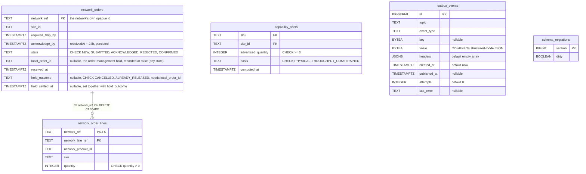

# Entity-relationship diagrams

The final schema after applying the migrations in order. There are two
separate databases:

- the **OLTP** database (`DATABASE_URL`): `migrations/0001_init`,
  `0002_outbox`, `0003_submitted_state`, `0004_capability_offers`,
  `0005_hold_outcome`;
- the **analytical** database (`ANALYTICS_DATABASE_URL`):
  `migrations/analytics/0001_report`, `0002_rejected_submission_failed`.

With `DATABASE_URL` unset the service runs on in-memory repositories and
uses neither.

A relationship line is drawn **only** where a real `FOREIGN KEY` exists.

## OLTP database

Source: `migrations/0001_init.up.sql`, `migrations/0002_outbox.up.sql`,
`migrations/0003_submitted_state.up.sql`, `migrations/0004_capability_offers.up.sql`,
`migrations/0005_hold_outcome.up.sql`;
`internal/adapters/outbound/postgres/migrate.go` (golang-migrate).

Omitted: indexes. They are `idx_network_orders_unanswered` (partial on
`acknowledge_by WHERE state = 'NEW'`), `idx_network_orders_local_order`
(partial, `local_order_id IS NOT NULL`), `network_orders_open_holds` (partial
on `acknowledge_by WHERE local_order_id IS NOT NULL AND hold_outcome IS NULL AND
state IN ('NEW', 'REJECTED')`, the orphaned-hold sweep's candidates; empty in a
healthy fleet), `idx_network_order_lines_sku` and
`idx_outbox_events_unpublished` (partial, `published_at IS NULL`).
The named CHECKs added by `0005` are `hold_outcome_vocabulary`,
`hold_outcome_has_settled_at` (outcome and instant are set together) and
`hold_outcome_requires_hold` (an outcome needs a `local_order_id`); the same
migration **drops** `local_order_requires_answer`, the CHECK that allowed
`local_order_id` only from `SUBMITTED` on (ADR 0024). The table `network_orders`
therefore now carries a `local_order_id` on a `NEW` or `REJECTED` order too.
`schema_migrations` is created by golang-migrate, not by a migration file;
its columns are shown as golang-migrate's Postgres driver creates them.

**Infrastructure tables:** `outbox_events` is the transactional outbox
(ADR 0003), one row per event per topic. `headers` holds the CloudEvents
`content-type` plus, when the row was written inside a span, its W3C
`traceparent` (ADR 0022); `attempts` counts failed sends and a row at
`OUTBOX_MAX_ATTEMPTS` is no longer claimed by the relay (ADR 0021). `schema_migrations` is
golang-migrate's bookkeeping. There is **no** `processed_events` inbox and
**no** `idempotency_keys` table in this database: the only OLTP Kafka
consumers are the two in-memory capability caches, and inbound idempotency
is "find by `network_ref` first".

**Logical links without a foreign key:**

- `network_orders.local_order_id` → `order-management`'s order id. That is
  another context's database, so the link is by value only (the persisted
  correlation of OM ADR 0018). It names the held order from the moment it is
  raised, so the orphaned-hold sweep can find and cancel it.
- `capability_offers.sku` / `network_order_lines.sku` → the same SKU
  vocabulary. They are separate aggregates and are deliberately not joined.
- `capability_offers.site_id` / `network_orders.site_id`: a shared value,
  not a reference.
- `outbox_events.key` holds the `network_ref` of the order that raised the
  event. It is a Kafka partition key, not a foreign key.

## Analytical database

Source: `migrations/analytics/0001_report.up.sql` and
`0002_rejected_submission_failed.up.sql` (adds
`orders_rejected_submission_failed`);
`internal/adapters/outbound/analyticsstore/postgres_projection.go`,
`consumed_events_repo.go`.

Omitted: the indexes `idx_analytics_processed_events_occurred_at` and
`idx_acknowledgement_rollup_day_bucket`. `DOUBLE_PRECISION` stands for the
SQL type `DOUBLE PRECISION`, because Mermaid needs a single token. There
are no foreign keys in this database.

**All tables here are analytics/projection or infrastructure tables.**
They are derived from the analytics event stream and are not a source of
truth. `analytics_consumed_events` is the consumer's dedupe gate; it is
written in the same transaction as the projection write (ADR 0023).
`analytics_processed_events` is claimed by the projection upsert and
drives freshness. `acknowledgement_rollup` is the report fact table.

## Table ≠ aggregate

| Table | Aggregate / role | Notes |
| --- | --- | --- |
| `network_orders` | **NetworkOrder** (root) | One row per aggregate. `Save` upserts on `network_ref`; there is no version column (no optimistic concurrency). |
| `network_order_lines` | **NetworkOrder** (its `Line`s) | Inserted with `ON CONFLICT DO NOTHING`; lines never change after receipt. |
| `capability_offers` | **CapabilityOffer** | One row per `(sku, site_id)`, upserted on every recompute. It is a snapshot with no history. |
| `outbox_events` | none (infrastructure) | Written in the same transaction as the aggregate by `postgres.OutboxPublisher`; drained by `postgres.OutboxRelay` (`FOR UPDATE SKIP LOCKED`). |
| `schema_migrations` | none (infrastructure) | golang-migrate. |
| `analytics_processed_events`, `analytics_consumed_events` | none (analytics infrastructure) | Idempotency for the projector. |
| `acknowledgement_rollup` | none (read model) | The "Acknowledgement & Translation" report. |
