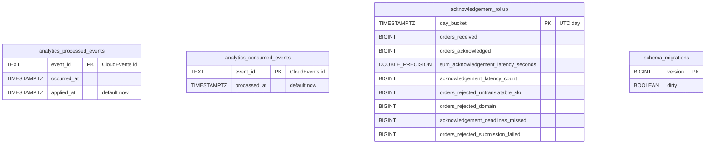

# Entity-relationship diagrams

The final schema after applying the migrations in order. There are two
separate databases:

- the **OLTP** database (`DATABASE_URL`): `migrations/0001_init`,
  `0002_outbox`, `0003_submitted_state`, `0004_capability_offers`,
  `0005_hold_outcome`, `0006_retail_network_map`, `0008_inbound_loop`,
  `0009_inbound_receipts`, `0010_node_profile`, `0011_inventory_feed`
  (there is no `0007`: the node-profile migration was written as 0007 and
  renumbered to 0010 when the inbound loop reached develop first, because
  golang-migrate never runs a file numbered below a database's current
  version);
- the **analytical** database (`ANALYTICS_DATABASE_URL`):
  `migrations/analytics/0001_report`, `0002_rejected_submission_failed`.

Both are required: there is no in-memory mode (ADR 0025).

A relationship line is drawn **only** where a real `FOREIGN KEY` exists.

## OLTP database

```mermaid
erDiagram
    network_orders ||--o{ network_order_lines : "FK network_ref, ON DELETE CASCADE"
    network_purchase_orders ||--o{ network_purchase_order_lines : "FK network_ref, ON DELETE CASCADE"
    network_purchase_orders ||--o{ network_labels : "FK network_ref, ON DELETE CASCADE"
    inbound_shipments ||--o{ inbound_receipt_cartons : "FK asn_number, ON DELETE CASCADE"
    inbound_shipments ||--o{ inbound_receipt_findings : "FK asn_number, ON DELETE CASCADE"
    inbound_shipments ||--|| inbound_receipts : "FK asn_number, ON DELETE CASCADE"
    network_nodes ||--|| network_node_profiles : "FK site_code"
    network_nodes ||--o{ network_inventory_feeds : "FK site_code"
    network_nodes ||--o{ network_rejected_listings : "FK site_code"
    network_orders {
        TEXT network_ref PK "the network's own opaque id"
        TEXT site_id
        TIMESTAMPTZ required_ship_by
        TIMESTAMPTZ acknowledge_by "receivedAt + 24h, persisted"
        TEXT state "CHECK NEW, SUBMITTED, ACKNOWLEDGED, REJECTED, CONFIRMED"
        TEXT local_order_id "nullable, the order-management hold, recorded at raise (any state)"
        TIMESTAMPTZ received_at
        TEXT hold_outcome "nullable, CHECK CANCELLED, ALREADY_RELEASED, needs local_order_id"
        TIMESTAMPTZ hold_settled_at "nullable, set together with hold_outcome"
    }
    network_order_lines {
        TEXT network_ref PK,FK
        TEXT network_line_ref PK
        TEXT network_product_id
        TEXT sku
        INTEGER quantity "CHECK quantity > 0"
    }
    capability_offers {
        TEXT sku PK
        TEXT site_id PK
        INTEGER advertised_quantity "CHECK >= 0"
        TEXT basis "CHECK PHYSICAL, THROUGHPUT_CONSTRAINED"
        TIMESTAMPTZ computed_at
    }
    network_nodes {
        TEXT site_code PK "siteCode to nodeId map, 0006"
        TEXT node_id "unique"
        TIMESTAMPTZ created_at "default now"
    }
    network_purchase_orders {
        TEXT network_ref PK "minted when the purchase order is first seen, 0006"
        TEXT po_number "unique"
        TEXT vendor_id
        TEXT node_id
        TIMESTAMPTZ required_ship_by
        TIMESTAMPTZ ack_by "the network's own deadline"
        TIMESTAMPTZ first_seen_at "default now"
    }
    network_purchase_order_lines {
        TEXT network_ref PK,FK
        INTEGER line_no PK "CHECK > 0"
        TEXT network_line_ref "unique with network_ref"
        TEXT listing_id
        TEXT network_product_id
        INTEGER quantity "CHECK > 0"
    }
    network_submissions {
        TEXT kind PK "ACKNOWLEDGEMENT, SHIPMENT_CONFIRMATION, NODE_REGISTRATION, NODE_PROFILE, INBOUND_RECEIPT, INVENTORY"
        TEXT subject PK
        TEXT idempotency_key "1-128 chars, written before the first HTTP call"
        BYTEA request_body "raw bytes; the network fingerprints them"
        TEXT transaction_id "nullable; never sent again once set"
        TEXT status "SENDING, PROCESSING, SUCCESS, FAILURE"
        TEXT errors
        TIMESTAMPTZ created_at "default now"
        TIMESTAMPTZ updated_at "default now"
    }
    network_labels {
        TEXT network_ref PK,FK
        INTEGER package_no PK "CHECK > 0"
        TEXT label_ref
        TEXT tracking_number "unique; one package per tracking number"
        TEXT carrier
    }
    inbound_shipments {
        TEXT shipment_ref PK "0008"
        TEXT asn_number "unique; the registered ASN"
        TEXT site_id
        TEXT owner_ref "default empty"
        TIMESTAMPTZ shipped_at
        TEXT status "PENDING, REGISTERED, REJECTED"
        INTEGER attempts "CHECK >= 0"
        TIMESTAMPTZ next_attempt_at "partial index where PENDING"
        TEXT last_error
        JSONB payload "the shipment tree as polled, for retry"
        TIMESTAMPTZ registered_at "nullable"
        TIMESTAMPTZ created_at "default now"
        TIMESTAMPTZ updated_at "default now"
    }
    inbound_poll_cursors {
        TEXT site_id PK "0008"
        TIMESTAMPTZ shipped_after
        TIMESTAMPTZ updated_at "default now"
    }
    gtin_sku_cache {
        TEXT gtin PK "14-digit, 0008"
        TEXT sku
        TEXT level
        INTEGER units_per_pack "CHECK >= 1"
        BOOLEAN active
        TIMESTAMPTZ resolved_at "default now"
    }
    inbound_receipt_events {
        TEXT event_id PK "CloudEvents id, 0009"
        TIMESTAMPTZ applied_at "default now"
    }
    inbound_receipt_cartons {
        TEXT asn_number PK,FK
        TEXT carton_key PK "SSCC, or the internal LPN of an unlabelled carton"
        TEXT sscc "default empty"
        TEXT receipt_id
        JSONB contents
        TIMESTAMPTZ received_at
    }
    inbound_receipt_findings {
        TEXT event_id PK "CloudEvents id, one row per discrepancy"
        TEXT asn_number FK "indexed"
        TEXT receipt_id
        TEXT sscc "default empty"
        TEXT kind
        TEXT expected "default empty"
        TEXT actual "default empty"
        TIMESTAMPTZ raised_at
    }
    inbound_receipts {
        TEXT asn_number PK,FK
        TEXT receipt_id
        TIMESTAMPTZ closed_at
        TEXT status "PENDING, SENT, REJECTED"
        INTEGER attempts "CHECK >= 0"
        TIMESTAMPTZ next_attempt_at "partial index where PENDING"
        TEXT last_error
        TIMESTAMPTZ sent_at "nullable"
        TIMESTAMPTZ created_at "default now"
        TIMESTAMPTZ updated_at "default now"
    }
    network_node_profiles {
        TEXT site_code PK,FK "0010"
        INTEGER revision "CHECK >= 1; only ever goes up"
        INTEGER attempt "default 1"
        TEXT fingerprint "of the revision's content"
        JSONB content "the profile in the fleet's own terms"
        TIMESTAMPTZ updated_at "default now"
    }
    network_inventory_feeds {
        TEXT site_code PK,FK "0011"
        INTEGER part PK "default 1"
        TEXT subject "ledger subject of the latest attempt"
        TEXT fingerprint
        TIMESTAMPTZ as_of "the pass the feed described"
        TIMESTAMPTZ updated_at "default now"
    }
    network_rejected_listings {
        TEXT site_code PK,FK "0011"
        TEXT listing_id PK
        TEXT reason "default empty"
        TIMESTAMPTZ rejected_at "retried after a day"
    }
    outbox_events {
        BIGSERIAL id PK
        TEXT topic
        TEXT event_type
        BYTEA key "nullable"
        BYTEA value "CloudEvents structured-mode JSON"
        JSONB headers "default empty array"
        TIMESTAMPTZ created_at "default now"
        TIMESTAMPTZ published_at "nullable"
        INTEGER attempts "default 0"
        TEXT last_error "nullable"
    }
    schema_migrations {
        BIGINT version PK
        BOOLEAN dirty
    }
```

Source: `migrations/0001_init.up.sql`, `migrations/0002_outbox.up.sql`,
`migrations/0003_submitted_state.up.sql`, `migrations/0004_capability_offers.up.sql`,
`migrations/0005_hold_outcome.up.sql`, `migrations/0006_retail_network_map.up.sql`,
`migrations/0008_inbound_loop.up.sql`, `migrations/0009_inbound_receipts.up.sql`,
`migrations/0010_node_profile.up.sql`, `migrations/0011_inventory_feed.up.sql`;
`internal/adapters/outbound/postgres/migrate.go` (golang-migrate).

Omitted: indexes. They are `idx_network_orders_unanswered` (partial on
`acknowledge_by WHERE state = 'NEW'`), `idx_network_orders_local_order`
(partial, `local_order_id IS NOT NULL`), `network_orders_open_holds` (partial
on `acknowledge_by WHERE local_order_id IS NOT NULL AND hold_outcome IS NULL AND
state IN ('NEW', 'REJECTED')`, the orphaned-hold sweep's candidates; empty in a
healthy fleet), `idx_network_order_lines_sku`,
`idx_outbox_events_unpublished` (partial, `published_at IS NULL`),
`network_submissions_unsettled` (partial on `kind, updated_at WHERE status IN
('SENDING', 'PROCESSING')`, the reconciliation candidates),
`inbound_shipments_due` and `inbound_receipts_due` (both partial on
`next_attempt_at WHERE status = 'PENDING'`) and
`inbound_receipt_findings_asn`.
The named CHECKs added by `0005` are `hold_outcome_vocabulary`,
`hold_outcome_has_settled_at` (outcome and instant are set together) and
`hold_outcome_requires_hold` (an outcome needs a `local_order_id`); the same
migration **drops** `local_order_requires_answer`, the CHECK that allowed
`local_order_id` only from `SUBMITTED` on (ADR 0024). The table `network_orders`
therefore now carries a `local_order_id` on a `NEW` or `REJECTED` order too.
`schema_migrations` is created by golang-migrate, not by a migration file;
its columns are shown as golang-migrate's Postgres driver creates them.

**Infrastructure tables:** `outbox_events` is the transactional outbox
(ADR 0003), one row per event per topic. `headers` holds the CloudEvents
`content-type` plus, when the row was written inside a span, its W3C
`traceparent` (ADR 0022); `attempts` counts failed sends and a row at
`OUTBOX_MAX_ATTEMPTS` is no longer claimed by the relay (ADR 0021). `schema_migrations` is
golang-migrate's bookkeeping. `network_submissions` is the submission ledger
of the live retail-network adapter (ADR 0026): one row per `(kind, subject)`,
with the idempotency key and the exact request body written **before** the
first HTTP call, so a retry after a crash re-sends byte for byte what was
first meant. `gtin_sku_cache` keeps product-master's GTIN→SKU answers so a
hot path never asks twice (only an answer is cached, never a miss).
`inbound_receipt_events` is the receipt consumer's dedupe gate: the
CloudEvents id of every applied inbound-receiving event, so a redelivery is
a no-op (ADR 0028). There is **no** `processed_events` inbox and
**no** `idempotency_keys` table in this database: the remaining OLTP Kafka
consumers are the two in-memory capability caches, and inbound HTTP
idempotency is "find by `network_ref` first".

The tables of `0006`, `0010` and `0011` belong to the live retail-network
adapter (`internal/adapters/outbound/retailnetwork`, ADR 0026 and ADR 0027);
in `NETWORK_MODE=stub` they stay empty. Those of `0008` and `0009` belong to
the inbound loop (ADR 0028): sellers ship SSCC-labelled cartons to a site,
the network reports the shipments through its vendor API, this service
registers an ASN in inbound-receiving and, when its receipt closes, reports
the receipt back — every step restart-safe because the state lives here.

**Logical links without a foreign key:**

- `network_orders.local_order_id` → `order-management`'s order id. That is
  another context's database, so the link is by value only (the persisted
  correlation of OM ADR 0018). It names the held order from the moment it is
  raised, so the orphaned-hold sweep can find and cancel it.
- `capability_offers.sku` / `network_order_lines.sku` → the same SKU
  vocabulary. They are separate aggregates and are deliberately not joined.
- `capability_offers.site_id` / `network_orders.site_id`: a shared value,
  not a reference.
- `outbox_events.key` holds the `network_ref` of the order that raised the
  event. It is a Kafka partition key, not a foreign key.
- The retail-network adapter tables deliberately have **no** foreign key to
  `network_orders`: the aggregate must not depend on which gateway answered
  for it. `network_purchase_orders.network_ref` ↔ `network_orders.network_ref`
  and `network_nodes.node_id` ↔ the node a `network_purchase_orders` row was
  issued to are links by value only.
- `inbound_shipments.asn_number` ↔ inbound-receiving's ASN, and
  `inbound_receipts.receipt_id` ↔ its receipt: another context's database,
  so the links are by value; the FKs that do exist here point at
  `inbound_shipments`, the local root of the inbound loop.
- `gtin_sku_cache.sku` / `network_inventory_feeds`' feed content ↔ the
  product-master and network vocabularies; the cache answers for a GTIN the
  feed lists, but neither is constrained.

## Analytical database

Source: `migrations/analytics/0001_report.up.sql` and
`0002_rejected_submission_failed.up.sql` (adds
`orders_rejected_submission_failed`);
`internal/adapters/outbound/analyticsstore/postgres_projection.go`,
`consumed_events_repo.go`.

Omitted: the indexes `idx_analytics_processed_events_occurred_at` and
`idx_acknowledgement_rollup_day_bucket`. `DOUBLE_PRECISION` stands for the
SQL type `DOUBLE PRECISION`, because Mermaid needs a single token. There
are no foreign keys in this database.

**All tables here are analytics/projection or infrastructure tables.**
They are derived from the analytics event stream and are not a source of
truth. `analytics_consumed_events` is the consumer's dedupe gate; it is
written in the same transaction as the projection write (ADR 0023).
`analytics_processed_events` is claimed by the projection upsert and
drives freshness. `acknowledgement_rollup` is the report fact table.

## Table ≠ aggregate

| Table | Aggregate / role | Notes |
| --- | --- | --- |
| `network_orders` | **NetworkOrder** (root) | One row per aggregate. `Save` upserts on `network_ref`; there is no version column (no optimistic concurrency). |
| `network_order_lines` | **NetworkOrder** (its `Line`s) | Inserted with `ON CONFLICT DO NOTHING`; lines never change after receipt. |
| `capability_offers` | **CapabilityOffer** | One row per `(sku, site_id)`, upserted on every recompute. It is a snapshot with no history. |
| `network_nodes`, `network_purchase_orders`, `network_purchase_order_lines`, `network_labels` | none (adapter state, ADR 0026) | The live retail-network adapter's memory: fleet ids ↔ network ids, and the labels a shipment confirmation must echo. Owned by `internal/adapters/outbound/retailnetwork`; empty in `NETWORK_MODE=stub`. |
| `network_submissions` | none (adapter state) | The submission ledger: idempotency key + exact request body per write kind, before the first HTTP call. |
| `network_node_profiles`, `network_inventory_feeds`, `network_rejected_listings` | none (adapter state, ADR 0027) | The supply loop's memory: the node-profile revision in force, where each feed part stands, and the listings the network refused. |
| `inbound_shipments`, `inbound_poll_cursors`, `gtin_sku_cache` | none (inbound-loop state, ADR 0028) | Shipments as polled (with retry), the per-site poll cursor, and the GTIN→SKU answer cache, in `internal/adapters/outbound/postgres`. |
| `inbound_receipt_events`, `inbound_receipt_cartons`, `inbound_receipt_findings`, `inbound_receipts` | none (inbound-loop projection + report queue, ADR 0028) | The local projection of inbound-receiving's receipt events (with consumer dedupe) and the queue of closed receipts still to report to the network. |
| `outbox_events` | none (infrastructure) | Written in the same transaction as the aggregate by `postgres.OutboxPublisher`; drained by `postgres.OutboxRelay` (`FOR UPDATE SKIP LOCKED`). |
| `schema_migrations` | none (infrastructure) | golang-migrate. |
| `analytics_processed_events`, `analytics_consumed_events` | none (analytics infrastructure) | Idempotency for the projector. |
| `acknowledgement_rollup` | none (read model) | The "Acknowledgement & Translation" report. |
