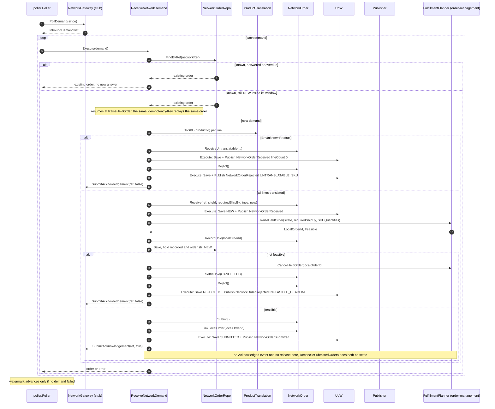
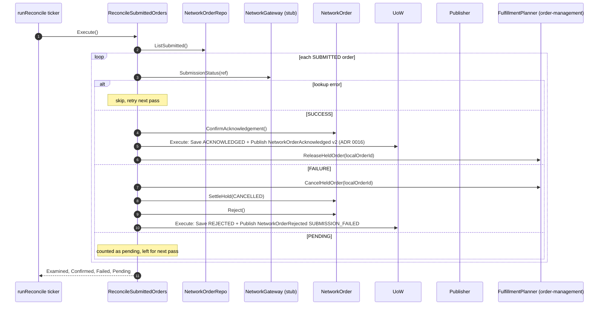
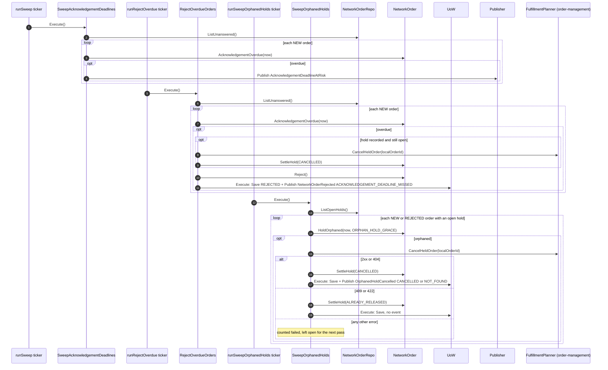
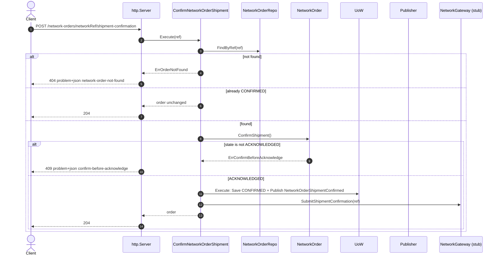
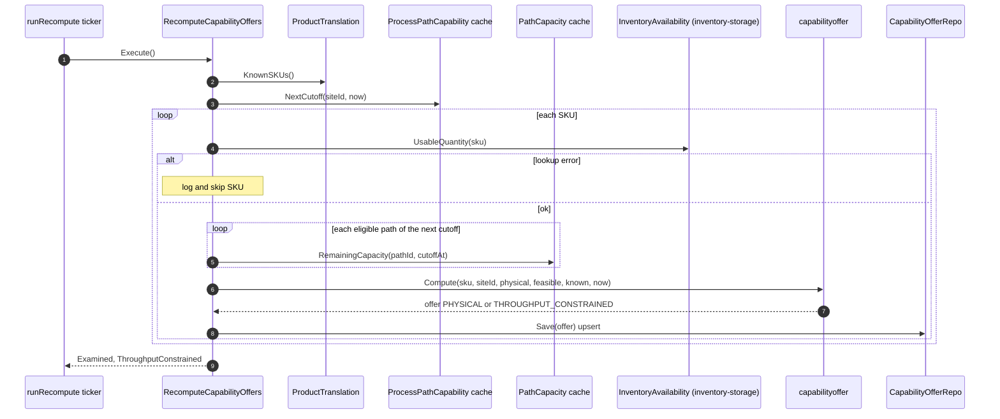
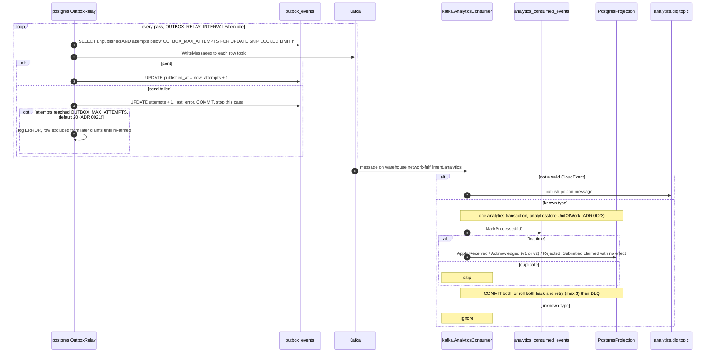

# Sequence diagrams

UML sequence diagrams for every command use case, derived from the use-case
function bodies in `internal/application/usecases/`. `UoW` is
`ports.UnitOfWork`, which is `postgres.UnitOfWork` (ADR 0025: Postgres is the only runtime;
unit tests substitute a fake). `Publisher` is the wired
`ports.EventPublisher`, the outbox publisher, which writes `outbox_events`
rows for both topics inside the transaction.

There is no idempotency-key middleware on this context's own routes and no
optimistic-concurrency
version check anywhere in this context. Idempotency comes from the state
checks shown below. (The one `Idempotency-Key` in play is outbound: the raise
to order-management carries `netful-raise-<networkRef>`.)

## 1. ReceiveNetworkDemand (poller)

Source: `internal/application/usecases/receive_network_demand.go`,
`internal/adapters/inbound/poller/poller.go`,
`internal/application/usecases/unit_of_work.go`.

Omitted: the error branches return early. A failed `RaiseHeldOrder` returns
`raise held order: ...` with the order already saved `NEW`; the next poll finds
it still `NEW` inside its window and resumes (first `alt` above). A failed
`CancelHeldOrder` returns `cancel held order: ...` with the hold already
recorded, so the order stays `NEW` and the poller, `RejectOverdueOrders` and
`SweepOrphanedHolds` can all still free it. A failed submit
returns `submit acknowledgement` or `submit rejection` after the record has
committed. Any error leaves the demand to be re-polled; the stub keeps it
pending until `SubmitAcknowledgement`. A non-`ErrUnknownProduct`
translation error aborts without saving anything. The untranslatable branch
and a lineless resumed order call no order-management method, so they have no
hold to free.

## 2. ReconcileSubmittedOrders (ticker, POLL_INTERVAL)

Source: `internal/application/usecases/reconcile_submitted_orders.go`,
`cmd/netfulfil/main.go` (`runReconcile`),
`internal/adapters/outbound/retailnetwork/stub.go` (`StubGateway.SubmissionStatus`).

Omitted: release and cancel run only when a `localOrderId` is linked, which
is always the case on this path. The stub reconciles any acknowledged
ref to `SUCCESS` immediately, so in stub mode `FAILURE` never occurs. A
per-order error is skipped and not counted.

## 3. SweepAcknowledgementDeadlines, RejectOverdueOrders and SweepOrphanedHolds (tickers, SWEEP_INTERVAL)

Source: `internal/application/usecases/sweep_acknowledgement_deadlines.go`,
`reject_overdue_orders.go`, `sweep_orphaned_holds.go`, `hold.go`,
`cmd/netfulfil/workers.go` (`runSweep`, `runRejectOverdue`,
`runSweepOrphanedHolds`).

Omitted: the deadline sweep's publish is **not** wrapped in a UoW, because it is
not a state change. A per-order failure in any pass is skipped and retried on
the next pass. Nothing is sent to the network. `RejectOverdueOrders` calls the
cancel only while the hold is open, and fails the order for this pass on any
non-2xx answer; the orphaned-hold sweep is the one that reads `404` and
`409`/`422` as answers, and only after `acknowledgeBy + ORPHAN_HOLD_GRACE`
(default `1h`), so it normally finds nothing. It never calls `Reject()`. It is
not started when `ORPHAN_HOLD_SWEEP_ENABLED=false`.

## 4. ConfirmNetworkOrderShipment (REST)

Source: `internal/application/usecases/confirm_network_order_shipment.go`,
`internal/adapters/inbound/http/server.go` (`handleConfirmShipment`),
`internal/adapters/inbound/http/errors.go`.

Omitted: an empty `networkRef` returns 422 (`ErrEmptyNetworkRef`). A failed
`SubmitShipmentConfirmation` returns 500 after the record has committed;
a retry is then a no-op that returns 204 without re-submitting. The 409
for `ErrConfirmBeforeAcknowledge` is a case in `statusFor`/`problemFor`
(`errors.go`), pinned by `TestHandleConfirmShipment_BeforeAcknowledgeReturns409`.
The route is registered only when `ConfirmShipment` is wired,
which `cmd/netfulfil` always does. CORS allows `GET/POST/OPTIONS`, so a
browser can call this route cross-origin.

## 5. RecomputeCapabilityOffers (ticker, RECOMPUTE_INTERVAL)

Source: `internal/application/usecases/recompute_capability_offers.go`,
`internal/domain/capabilityoffer/capability_offer.go`,
`cmd/netfulfil/main.go` (`wireCapabilityOffer`, `runRecompute`).

Omitted: there is no UoW and no event. The whole use case is always wired
at boot, after both caches pass `WaitReady`.
When `NextCutoff` reports no schedule, the capacity loop is skipped and
`known=false`.

## 6. Outbox relay and analytics projection

Source: `internal/adapters/outbound/postgres/outbox_relay.go`,
`outbox_publisher.go`, `internal/adapters/inbound/kafka/analytics_consumer.go`,
`internal/adapters/outbound/analyticsstore/`.

Omitted: the relay, which is always on. Phase retries (up to 3, with exponential backoff)
precede a DLQ on infrastructure errors. `cmd/netfulfil-reports` reads
`acknowledgement_rollup` over a read-only pool.
