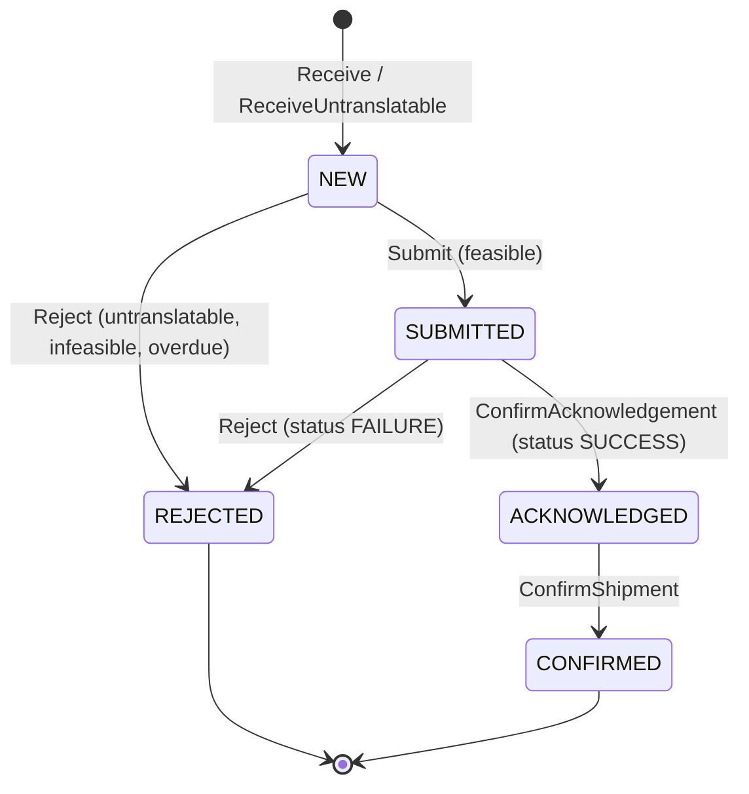

# Application use cases

The eight application services in `internal/application/usecases`, as they are
on `develop`: what triggers each one, what it takes, which invariants it
relies on, what it calls and which events it raises. The step-by-step
sequence diagrams are in [sequence-diagrams.md](/docs/ddd/sequence-diagrams); the
event payloads are in
[ecosystem/integration.md](/docs/ecosystem/integration#events-published).

Reads are not use cases here. `GET /network-orders`,
`GET /network-orders/{networkRef}`, `GET /capability-offers` and the MCP
tools read the repositories directly (`internal/adapters/inbound/http/server.go`,
`internal/adapters/inbound/mcp/tools.go`).

## Triggers at a glance

| Use case | Trigger | Cadence / entry point | Wired in |
| --- | --- | --- | --- |
| `ReceiveNetworkDemand` | poller (scheduler) | once at start, then every `POLL_INTERVAL` | `cmd/netfulfil/main.go`, `internal/adapters/inbound/poller/poller.go` |
| `ReconcileSubmittedOrders` | ticker | every `POLL_INTERVAL` | `cmd/netfulfil/workers.go` |
| `SweepAcknowledgementDeadlines` | ticker | every `SWEEP_INTERVAL` | `cmd/netfulfil/workers.go` |
| `RejectOverdueOrders` | ticker | every `SWEEP_INTERVAL` (its own ticker) | `cmd/netfulfil/workers.go` |
| `SweepOrphanedHolds` | ticker | every `SWEEP_INTERVAL` (its own ticker, the same interval as the two passes above); not started when `ORPHAN_HOLD_SWEEP_ENABLED=false` | `cmd/netfulfil/workers.go` (`runSweepOrphanedHolds`), built in `cmd/netfulfil/wiring.go` (`wireOrphanHoldSweep`) |
| `ConfirmNetworkOrderShipment` | REST | `POST /network-orders/{networkRef}/shipment-confirmation` | `internal/adapters/inbound/http/server.go` |
| `RecomputeCapabilityOffers` | ticker | every `RECOMPUTE_INTERVAL`, always | `cmd/netfulfil/capability.go` |
| `DeclareNodeProfiles` | worker | live mode only: once at start, then every `NETWORK_PROFILE_INTERVAL` (`0` disables) | `cmd/netfulfil/profile.go` (`wireNodeProfiles`, `startProfileWorker`) |

No use case is driven by Kafka or by MCP. The two Kafka consumers in
`netfulfil` only fill caches that `RecomputeCapabilityOffers` and `DeclareNodeProfiles` read; the
projector's consumer feeds the analytics store, not a use case.

## How Save and Publish commit

Every use case that changes a `NetworkOrder` saves it and publishes its event
inside `atomically(...)` (`unit_of_work.go`). The unit
of work is one Postgres transaction (`cmd/netfulfil/wiring.go`) and the
publisher writes the `outbox_events` rows inside that same transaction
(ADR 0003, ADR 0025). Unit tests with fakes run the two calls back to back.
External calls (order-management, the network) are made **outside** that
scope, in a fixed order explained per use case below.

## NetworkOrder lifecycle

Source: `internal/domain/networkorder/network_order.go`.

## ReceiveNetworkDemand

`receive_network_demand.go`. Turns one unit of network demand into an
answered order.

- **Input**: `contract.InboundDemand` from `NetworkGateway.PollDemand`:
  `networkRef`, `siteId`, `requiredShipBy`, `lines[]` (`networkLineRef`,
  `networkProductId`, `quantity`).
- **Steps**:
  1. Idempotency: if an order with this `networkRef` exists and is not `NEW`,
     or its window has closed, return it unchanged. Nothing is re-answered. An
     order still `NEW` inside its window was recorded but never answered
     (order-management was down, or the process stopped after the save), so it
     **resumes** at step 5 instead (a lineless one is rejected
     `UNTRANSLATABLE_SKU`).
  2. Translate every line's `networkProductId` to a SKU through
     `ProductTranslation`. One unknown product rejects the whole order.
  3. Untranslatable: build a lineless order (`ReceiveUntranslatable`), save
     it with `NetworkOrderReceived` (`lineCount: 0`), then reject it with
     `UNTRANSLATABLE_SKU` (below). No order-management call.
  4. Otherwise build the order (`Receive`), save it `NEW` and publish
     `NetworkOrderReceived` in one scope.
  5. `FulfillmentPlanner.RaiseHeldOrder`: `POST /orders` with
     `releaseOnAllocation: false`, `allowPartialShipment: false`,
     `requiredShipBy` and `Idempotency-Key: netful-raise-<networkRef>`, so a
     retry replays the same order-management order. A `promiseDate` means
     feasible, `null` means not.
  6. Record the hold: `NetworkOrder.RecordHold(id)` and `Save`, right after the
     raise returns and before any decision (ADR 0024 §1). The order stays `NEW`
     but now names its hold, so a failure from here on leaves something the
     cancel paths and `SweepOrphanedHolds` can find.
  7. Not feasible: `freeHold` (`DELETE /orders/{id}`, then the hold outcome
     `CANCELLED` is set on the order), `Reject`, save and publish
     `NetworkOrderRejected` (`INFEASIBLE_DEADLINE`) in one scope, then
     `SubmitAcknowledgement(ref, false)`.
  8. Feasible: `Submit` (to `SUBMITTED`), `LinkLocalOrder(id)` (a no-op, the id
     is already recorded), save and publish `NetworkOrderSubmitted` in one
     scope, then `SubmitAcknowledgement(ref, true)`. The hold is **not**
     released here; `ReconcileSubmittedOrders` does that once the network
     settles it.
- **Invariants** (domain): `networkRef` not empty; at least one line
  (`ErrNoLines`) except for the untranslatable constructor; each line has a
  line ref, a product id and a positive quantity; `acknowledgeBy` is
  `receivedAt + 24h` (`AcknowledgementWindow`); `Submit` and `Reject` only
  from `NEW` (`ErrAlreadyAnswered`); the hold is recorded only on a `NEW` order
  (`RecordHold`, `ErrAlreadyAnswered` otherwise), idempotent for the same id and
  `ErrLocalOrderAlreadyLinked` for another; `LinkLocalOrder` only from
  `SUBMITTED` on, also idempotent for the same id.
- **Events**: `NetworkOrderReceived`, then either `NetworkOrderSubmitted` or
  `NetworkOrderRejected` (`UNTRANSLATABLE_SKU` or `INFEASIBLE_DEADLINE`).
- **Failure**: any error is returned to the poller, which logs
  `receive network demand failed`, counts it in `/inbound-status` `failed`
  and keeps the watermark, so the unit is fetched again. An order saved `NEW`
  before step 5 failed is found on the next poll and resumed (step 1), as long
  as its window is open; the raise replays the same order. If the cancel in
  step 7 fails, the order stays `NEW` with its hold recorded: the poller
  retries inside the window, `RejectOverdueOrders` after it, and
  `SweepOrphanedHolds` after `ORPHAN_HOLD_GRACE`. A process stop between
  order-management committing the raise and step 6 is healed inside the window
  (the re-delivery replays the raise and records the id); only if the window
  closes first does nothing name the hold, see the
  [runbook](/docs/operations/runbook#a-held-order-is-stuck-in-order-management).

## ReconcileSubmittedOrders

`reconcile_submitted_orders.go`. Settles orders left `SUBMITTED` (ADR 0001
§5): a successful submit call is only accepted-for-processing.

- **Input**: none; it lists `NetworkOrderRepo.ListSubmitted`.
- **Per order**: `NetworkGateway.SubmissionStatus(ref)`:
  - `SUCCESS`: `ConfirmAcknowledgement` (to `ACKNOWLEDGED`), save and publish
    `NetworkOrderAcknowledged` (v2) in one scope, then
    `POST /orders/{localOrderId}/release`.
  - `FAILURE`: `freeHold` first (`DELETE /orders/{localOrderId}`, then the hold
    outcome `CANCELLED` is recorded), then `Reject`, save and publish
    `NetworkOrderRejected` (`SUBMISSION_FAILED`). The outcome is saved in the
    same write as the rejection; before ADR 0024 that write was refused by a
    database CHECK and the order stayed `SUBMITTED`.
  - `PENDING` or a lookup error: left for the next pass.
- **Invariants**: `ConfirmAcknowledgement` only from `SUBMITTED`
  (`ErrNotSubmitted`); `Reject` from `NEW` or `SUBMITTED`.
- **Events**: `NetworkOrderAcknowledged` (`...NetworkOrderAcknowledged.v2`)
  or `NetworkOrderRejected`.
- **Failure**: a failure on one order skips it and the pass continues.
  If the release call fails after the `ACKNOWLEDGED` commit, the order is no
  longer `SUBMITTED` and is not retried (see
  [troubleshooting](/docs/operations/troubleshooting#network-orders)).

## SweepAcknowledgementDeadlines

`sweep_acknowledgement_deadlines.go`. Reports orders whose 24 h window has
closed unanswered (ADR 0001 §6).

- **Input**: none; it lists `ListUnanswered` (state `NEW`, ordered by
  `acknowledge_by`).
- **Rule**: `AcknowledgementOverdue(now)`: state `NEW` and `now` after
  `acknowledgeBy`.
- **Effect**: publishes `AcknowledgementDeadlineAtRisk` for each overdue
  order. It never changes the aggregate and has no unit of work, so with the
  outbox the event row is written on its own.
- **Events**: `AcknowledgementDeadlineAtRisk`, again on every pass while the
  order stays `NEW` and overdue.
- **Failure**: a publish failure skips that order for this pass.

## RejectOverdueOrders

`reject_overdue_orders.go`. The separate path that actually rejects an order
whose window closed. It never acknowledges late.

- **Input**: none; same `ListUnanswered` listing and the same overdue rule.
- **Per overdue order**: `freeHold`: cancel the recorded hold if it is still
  open (`DELETE /orders/{id}`) and record the outcome `CANCELLED`, or skip the
  call when the order has no hold or the orphaned-hold sweep already settled
  it; then `Reject`, save and publish `NetworkOrderRejected`
  (`ACKNOWLEDGEMENT_DEADLINE_MISSED`) in one scope.
- **Events**: `NetworkOrderRejected`.
- **Failure**: one failing order is skipped; the next pass retries it. Any
  non-2xx answer to the cancel (a `404` or a `409`/`422` included) is a failure
  here and the order is retried; `SweepOrphanedHolds` classifies those answers
  and, once `ORPHAN_HOLD_GRACE` has passed, records the outcome so this use
  case can skip the cancel and reject.
- Note from the code: since ADR 0024 the hold is recorded on the order when it
  is raised, so the cancel branch now fires for an order that stayed `NEW`.
  Before it, the id was written only from `SUBMITTED` on and this branch never
  found a hold to cancel.

## SweepOrphanedHolds

`sweep_orphaned_holds.go` (ADR 0024, gap OM-0020). Frees an
`order-management` hold nobody decided. `order-management` has no timeout on a
held order, so the clock lives here; this is the backstop for
`RejectOverdueOrders`. Independent of the other two sweeps: none depends on
another having run.

- **Input**: none; it lists `NetworkOrderRepo.ListOpenHolds` (hold recorded,
  no outcome, state `NEW` or `REJECTED`).
- **Rule** (domain, `NetworkOrder.HoldOrphaned(now, grace)`): the hold is open,
  the state is `NEW` or `REJECTED`, and `now` is strictly after
  `acknowledgeBy + grace`. `grace` is `ORPHAN_HOLD_GRACE` (default `1h`).
  `SUBMITTED`, `ACKNOWLEDGED` and `CONFIRMED` are never orphaned.
- **Per orphaned hold**: `FulfillmentPlanner.CancelHeldOrder`
  (`DELETE /orders/{id}`) and classify order-management's answer (the planner
  turns the status into two sentinel errors in `internal/application/contract`):

  | Answer | Meaning | Action |
  | --- | --- | --- |
  | 2xx | cancelled | `SettleHold(CANCELLED)`, save and publish `OrphanedHoldCancelled` (`answer` `CANCELLED`) in one scope |
  | 404 (`ErrHeldOrderNotFound`) | the hold no longer exists | the same, `answer` `NOT_FOUND` |
  | 409 or 422 (`ErrHeldOrderAlreadyReleased`) | already released: not an orphan | `SettleHold(ALREADY_RELEASED)`, saved, **no event**, never retried |
  | anything else (5xx, timeout, transport error, open breaker) | unknown | nothing recorded, counted `failed`, retried next pass |

- **Never**: changes the order's state (`RejectOverdueOrders` owns that), or
  reads anything from order-management except the answer to the cancel.
- **Events**: `OrphanedHoldCancelled`, once per freed hold. It is a reported
  fact, not a state transition.
- **Metric**: `network_fulfillment.orphaned_holds.swept` by `outcome`
  (`cancelled`, `already_released`, `failed`), through `ports.OrphanHoldMetrics`.
- **Failure**: one bad hold never aborts the pass; the pass result is
  `Examined`, `Cancelled`, `AlreadyReleased`, `Failed`, logged as WARN
  `orphaned holds swept` when any of the last three is non-zero. A failed save
  is retried safely because order-management's cancel is idempotent. With
  several `netfulfil` replicas two can both cancel the same hold and both
  publish the event.

## ConfirmNetworkOrderShipment

`confirm_network_order_shipment.go`, driven by
`POST /network-orders/{networkRef}/shipment-confirmation` (ADR 0014). No
`PackageManifested` consumer exists.

- **Input**: `networkRef` from the path. No body.
- **Steps**: load the order (`404 network-order-not-found` if absent); if it
  is already `CONFIRMED`, return it (`204`, no second event, no second
  network call); otherwise `ConfirmShipment`, save and publish
  `NetworkOrderShipmentConfirmed` in one scope, then
  `NetworkGateway.SubmitShipmentConfirmation`.
- **Invariant**: `ConfirmShipment` only from `ACKNOWLEDGED`
  (`ErrConfirmBeforeAcknowledge`, `409 confirm-before-acknowledge`).
- **Events**: `NetworkOrderShipmentConfirmed`.
- **Failure**: if the gateway call fails after the commit the route answers
  `500 internal-error`; the order is already `CONFIRMED`, so a retry returns
  `204` without calling the gateway again.

## RecomputeCapabilityOffers

`recompute_capability_offers.go` (ADR 0001 §8, ADR 0017). Computes what this
context would advertise per SKU at `SITE_ID`. Always on.

- **Input**: none; the SKU list is `ProductTranslation.KnownSKUs` (every SKU
  the dictionary maps to).
- **Per SKU**:
  - `physicalAvailable` = inventory-storage `GET /inventory/{sku}/usable`.
  - `throughputFeasible` = the sum of `RemainingCapacity(pathId, cutoffAt)`
    over the paths eligible for the site's next **feasible** cutoff
    (`ProcessPathCapability.NextCutoff`), counting only paths whose
    capacity is known. A path is eligible only if its `CycleTimeP95` fits
    the time left to the cutoff; unknown or zero cycle time stays eligible.
    No schedule, or no known capacity, means "unknown". When every path is
    ruled out by cycle time for the next cutoff, the pass walks to the
    following cutoff, and on, up to 7 days ahead (ADR 0031); only no
    feasible cutoff inside that bound is a proven zero. Resolved once per
    pass, not per SKU.
  - `capabilityoffer.Compute`: `advertisedQuantity = min(physical,
    throughputFeasible)` with basis `THROUGHPUT_CONSTRAINED` when throughput
    is known and lower, else `physical` with basis `PHYSICAL`.
  - `CapabilityOfferRepo.Save` (upsert per `(sku, siteId)`).
- **Invariants** (`capability_offer.go`): SKU and site not empty, quantity
  not negative, advertised never above physical, basis one of the two.
- **Events**: none. The offer is not sent to the network by this use case: the
  inventory feed ([FeedInventory](#feedinventory)) reads the persisted offers.
- **Failure**: an inventory, compute or save error is logged and that SKU is
  skipped; the pass continues.

## DeclareNodeProfiles

`declare_node_profiles.go` and `profile_derivation.go` (ADR 0027 part 1). Declares,
per site, how the building operates, so that the network can show it and judge our
acknowledgement deadlines by it. Live mode only; the stub never starts the worker.

- **Input**: none; the sites are the ones the live gateway converges onto nodes
  (`SITE_ID` plus the node file's).
- **Per site**: the whole weekly schedule from `ProcessPathCapability.Schedule`
  (cutoffs that share a local time are one cutoff, with their days united);
  `HandlingTime` = the longest known, positive `CycleTimeP95` among the paths
  eligible for any cutoff that fits the longest gap of the schedule, rounded UP to
  whole minutes; each cutoff's `MaxOrders` = the sum of `RemainingCapacity` over the
  paths eligible for its next occurrence whose figure is known (0 = unknown), and
  never below what was last declared for the same slot (`ProfileHistory`);
  `ThroughputPerDay` = the sum of the known ceilings of the busiest weekday.
- **Never guessed**: no schedule (`skipped_no_schedule`), no usable cycle time or no
  capacity figure (`skipped_incomplete`) is a logged `WARN` and nothing is
  declared. A site with no node yet (`contract.ErrSiteNotRegistered`) is a
  `skipped_no_node`, not a failure.
- **Calls**: `NetworkGateway.DeclareNodeProfile`, which owns the revision: it only
  bumps it when the `Fingerprint` (a hash of the content, independent of the order
  the caches list it in) changed, persists it before the HTTP call, and reconciles
  the transaction by its persisted id.
- **Events**: none. **Metrics**: `network_fulfillment.node_profile.declarations`
  and `.revision` ([observability](/docs/operations/observability#node-profile-metrics)).
- **Failure**: one site's failure is logged and never stops the others; a
  cancelled context stops the pass before the next site; a memory that cannot be
  read (`LastDeclared`) means the site is left for the next pass rather than
  declared with a ceiling that might be lowered.

## FeedInventory

`feed_inventory.go` and `feed_plan.go` (ADR 0027 part 2). Tells the network, per site,
what the site claims it can ship. Live mode only; the stub never starts the worker.
Reads local data only: the persisted `CapabilityOffer`s and the product dictionary.

- **Input**: none; the sites are the ones the live gateway converges onto nodes
  (`SITE_ID` plus the node file's).
- **Per site** (`planInventoryFeeds`, pure): the site's *pass* is the set of its offers
  sharing the newest `ComputedAt`, which is the feed's `AsOf`; an offer of an earlier
  pass is not fresh and is not fed. Only a SKU the site has a listing for
  (`FeedCatalogue.ListedSKUs`) is a line (`advertisedQuantity`, `basis`; an unknown
  figure is never an offer). The feed is `Complete` only when every listed SKU has a
  fresh offer and it fits in one part; above `contract.MaxFeedLines` (5000) it is
  split into partial parts with the same `AsOf`. The fingerprint hashes the complete
  flag and the lines, not the moment.
- **Unlisted SKUs**: an offer for a SKU with no listing at the site is expected, not an
  error: it is not fed and is logged once per process at `INFO`.
- **Calls**: `NetworkGateway.SubmitInventoryFeed`, which owns delivery: it sends a feed
  when its fingerprint changed, repeats an unchanged one at most hourly, keeps out of
  the feed a listing the network refused as not on the node, and reconciles the
  transaction by its persisted id.
- **Outcomes** (`contract.FeedOutcome`): `sent`, `confirmed`, `pending`, `unchanged`,
  `failed`, `skipped_no_node` (`contract.ErrSiteNotRegistered`), `skipped_no_offers`,
  `skipped_no_listings`.
- **Events**: none. **Metrics**: none; logs only
  ([runbook](/docs/operations/runbook#the-inventory-feed)).
- **Failure**: one site's failure is logged and never stops the others; a cancelled
  context stops the pass before the next site; offers that cannot be read fail every
  site for this pass and the next one retries.
