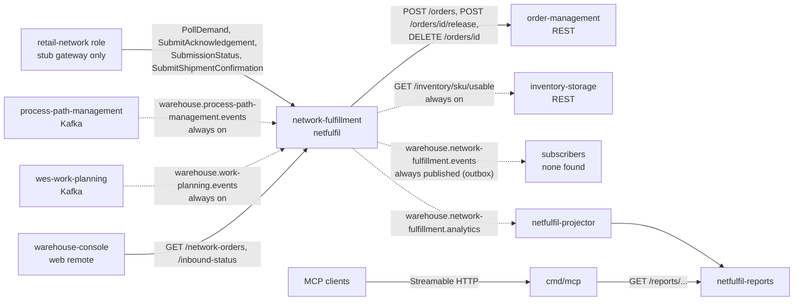

# Integration (upstream and downstream)

Every edge between network-fulfillment and something else, read from the
adapters on `develop`: the protocol, the exact contract (endpoints, topics,
CloudEvents `type`s) and what happens when the other side fails. Edges that
look like they should exist but do not are listed at the end.

The DDD view of the same edges (Conformist, Customer/Supplier, Open Host) is
in [ddd/context-map.md](/docs/ddd/context-map). Configuration of each edge is
in [operations/configuration.md](/docs/operations/configuration).

Source: `internal/adapters/outbound/retailnetwork/mode.go`,
`internal/adapters/outbound/ordermanagement/planner.go`,
`internal/adapters/outbound/inventoryclient/client.go`,
`internal/adapters/outbound/processpathcache/consumer.go`,
`internal/adapters/outbound/pathcapacitycache/consumer.go`,
`internal/adapters/outbound/kafka/publisher.go`,
`internal/adapters/outbound/kafka/analytics_publisher.go`,
`internal/adapters/inbound/mcp/report_tool.go`, `cmd/mcp/main.go`.
Dotted arrows are off by default. Path parameters are written `id` / `sku`
inside the diagram for `{id}` / `{sku}`.

## Summary

| Peer | Direction | Protocol | Contract | Default | On failure |
| --- | --- | --- | --- | --- | --- |
| retail network (`retail-network` plays the role, ADR 0009) | upstream | in-process port `ports.NetworkGateway` | poll demand, submit acknowledgement (with a reason), submission status, request label, shipment confirmation | `stub` (`live` is ADR 0026, opt-in) | see [The network](#the-network) |
| `order-management` | downstream of our call (we are its Customer) | REST, synchronous | `POST /orders`, `POST /orders/{id}/release`, `DELETE /orders/{id}` | always on | error propagates, one circuit breaker, no retry |
| `inventory-storage` | upstream | REST, synchronous | `GET /inventory/{sku}/usable` | always on | SKU skipped for that recompute pass |
| `process-path-management` | upstream | Kafka, CloudEvents | 4 event types on `warehouse.process-path-management.events` | always on | bad message logged and skipped, no DLQ |
| `wes-work-planning` | upstream | Kafka, CloudEvents | `PathCapacityChanged` on `warehouse.work-planning.events` | always on | bad message logged and skipped, no DLQ |
| any subscriber | downstream | Kafka, CloudEvents | 7 event types on `warehouse.network-fulfillment.events` | always on (outbox relay) | outbox keeps unsent rows |
| own analytics (`netfulfil-projector`) | internal | Kafka, CloudEvents | same 7 types on `warehouse.network-fulfillment.analytics` (it ignores `NetworkOrderShipmentConfirmed`, `AcknowledgementDeadlineAtRisk` and `OrphanedHoldCancelled`) | always on | retry 3 times, then `.dlq` |
| `warehouse-console` (via `web/` remote) | downstream | REST | `GET /network-orders`, `GET /inbound-status` | on | n/a |
| MCP clients | downstream | MCP, Streamable HTTP | 4 read-only tools | `mcp.enabled` | n/a |
| A2A agents | downstream | A2A, JSON-RPC over HTTP | 2 read-only skills (ADR 0030) | `a2a.enabled` | n/a |

REST, MCP and A2A are unauthenticated, like every context in the fleet. Through
Kong the REST API is at `/api/network-fulfillment` and the reports API at
`/api/network-fulfillment/reports`.

## The network

`ports.NetworkGateway` (`internal/application/ports/ports.go`) is the only
route to the external network, and `NETWORK_MODE` picks its implementation
(`internal/adapters/outbound/retailnetwork/mode.go`):

- `stub` (default, and any unrecognised value): `StubGateway`, in process
  memory, no network call at all.
- `live` ([ADR 0026](/docs/adr/0026-live-retail-network-adapter-demand-loop)):
  `LiveGateway`, the demand loop against the retail network's Vendor API at
  `NETWORK_BASE_URL` as `NETWORK_VENDOR_ID`. It polls purchase orders, answers
  each once (accept, or reject with a reason mapped inside the adapter),
  reconciles by a persisted transaction id, requests labels and confirms
  shipments. Every write carries a deterministic `Idempotency-Key`; calls are
  retried with backoff behind one circuit breaker. The network's identifiers
  (purchase order number, listing, node, transaction) live only in the
  adapter's tables (migration 0006). A background use case, `DeclareNodeProfiles`
  ([ADR 0027](/docs/adr/0027-supply-loop-node-profile-and-inventory-feed) part 1),
  derives each site's operational profile (cutoffs, handling time, throughput)
  from the local CPT schedule, cycle-time and capacity caches and declares it with
  `PUT /vendor/nodes/{nodeId}/profile` under a revision this service persists
  (migration 0010) and never lowers. A second worker, `FeedInventory`
  (ADR 0027 part 2), feeds each site's capability offers with
  `POST /vendor/inventory` (migration 0011) under the listings of the product
  dictionary. Without `NETWORK_BASE_URL`
  or `NETWORK_VENDOR_ID` the boot fails, naming each missing one.

What the stub does for each port method (the live behaviour is in ADR 0026):

| Port method | Called by | Stub behaviour |
| --- | --- | --- |
| `PollDemand(since)` | poller, every `POLL_INTERVAL` | returns every seeded unit still pending; ignores `since` |
| `SubmitAcknowledgement(ref, {accepted, reason})` | `ReceiveNetworkDemand`, `ReconcileSubmittedOrders` (resend) | records the answer and removes the unit from the pending list |
| `SubmissionStatus(ref)` | `ReconcileSubmittedOrders` | `SUCCESS` for a ref this process submitted, `PENDING` otherwise (so after a restart every earlier submission is `PENDING`) |
| `SubmitShipmentConfirmation(ref, shippedAt)` | `ConfirmNetworkOrderShipment` | records it |
| `SubmitInventoryFeed(feed)` | `FeedInventory`, live mode only (the stub never starts the worker) | logs it and sends nothing; replaces the old `SubmitAvailability` |
| `DeclareNodeProfile(profile)` | `DeclareNodeProfiles`, live mode only (the stub never starts the worker) | records the last profile per site and sends nothing; replaces the old `DeclareCapability`, which the real API never had |
| `RequestLabel(ref, packageCount)` | `ConfirmNetworkOrderShipment` (one package), before it records `CONFIRMED` | deterministic fake `{labelRef, trackingNumber, carrier}` per package |

Demand gets into the stub only from `NETWORK_SEED_FILE` (ADR 0012); the
chart renders it from `stubDemand.demands`. No ship-to PII exists anywhere in
the contract (ADR 0009 §3).

Failure behaviour: a `PollDemand` error is logged (`poll demand failed`) and
the watermark does not move. A unit whose `ReceiveNetworkDemand` fails is
logged and retried on the next poll. A `SubmissionStatus` error leaves the
order `SUBMITTED` for the next pass.

## order-management

Client: `internal/adapters/outbound/ordermanagement/planner.go`, wrapped by
`breaker.go`. Base URL `ORDER_MANAGEMENT_URL` (default
`http://localhost:8080`; the kind overlay sets
`http://order-management.<apps namespace>.svc.cluster.local:80`).

| Call | When | Body / meaning |
| --- | --- | --- |
| `POST /orders` | `ReceiveNetworkDemand`, after the order is saved `NEW` | `{"lines":[{"sku","quantity"}],"releaseOnAllocation":false,"allowPartialShipment":false,"requiredShipBy":"<RFC 3339>"}` with header `Idempotency-Key: netful-raise-<networkRef>`. A response with `promiseDate` means feasible; `promiseDate: null` means the deadline cannot be met (a verdict, not an error). The response `id` is recorded on the order as its hold (`local_order_id`) as soon as the call returns, before the verdict is acted on (ADR 0024); REST and MCP show it as `localOrderId` from `SUBMITTED` on. |
| `DELETE /orders/{id}` | rejecting an infeasible order, `SUBMISSION_FAILED`, `RejectOverdueOrders`, and `SweepOrphanedHolds` for a hold nobody decided | cancels the hold and frees the reservations. order-management's cancel is idempotent (a second cancel of a cancelled order is a 204). The sweep reads the answer as: 2xx or `404` = the hold is gone (outcome `CANCELLED`, event `OrphanedHoldCancelled`), `409` or `422` = already released (outcome `ALREADY_RELEASED`, no event, not retried), anything else = failure, retried on the next pass. |
| `POST /orders/{id}/release` | `ReconcileSubmittedOrders`, when the network confirms | puts the held order on the floor |

Feasibility is asked, never computed here (ADR 0001 §7). The contract is the
Supplier half in order-management's ADR 0020.

Failure behaviour:

- Any status `>= 300`, transport error or decode error is returned as
  `order-management <METHOD> <path>: status <n>` and fails the use case. No
  call is retried by the client (they are all mutations). For the cancel only,
  `404` and `409`/`422` come back wrapped as two sentinel errors
  (`contract.ErrHeldOrderNotFound`, `contract.ErrHeldOrderAlreadyReleased`)
  with the same message; `SweepOrphanedHolds` treats them as answers, every
  other caller still treats them as failures.
- One gobreaker instance guards all three calls (ADR 0004). It opens after 5
  consecutive failures or more than 50 % failures over at least 10 calls in
  a 30 s window, stays open 30 s, then lets one probe through. While open,
  calls fail with `order-management: circuit breaker open, call not attempted`.
  A `404`, `409` or `422` on the cancel counts as a successful call, not a
  dependency failure. There is no fallback. The state is the
  `circuit_breaker_state` gauge on
  `GET /metrics` (see [observability](/docs/operations/observability)).
- Each call has a 10 s `http.Client` timeout and a context deadline capped at
  30 s.
- `POST /orders` is sent with a stable `Idempotency-Key`,
  `netful-raise-<networkRef>`, which order-management requires and replays
  for 24 hours, so the poller's retry of a raise returns the same order id
  instead of reserving stock twice.

## inventory-storage

Client: `internal/adapters/outbound/inventoryclient/client.go`, base URL
`INVENTORY_STORAGE_URL`. Wired at boot, always on.

- `GET /inventory/{sku}/usable` returns `{"sku","usable"}`; `usable` is the
  physical side of the capability offer. An unknown SKU is `usable: 0` by
  inventory-storage's contract.
- Called by `RecomputeCapabilityOffers` once per known SKU per pass, never on
  a request path.
- Failure: status `>= 300`, transport or decode error is logged as
  `capability offer: usable inventory lookup failed` and that SKU keeps its
  previous offer row until a later pass succeeds. 10 s timeout, no breaker,
  no retry.

Why REST and not a Kafka cache: inventory-storage publishes its stock ledger
only to its analytics topic, and rebuilding its usable-quantity projection
here would duplicate its math (the `ports.InventoryAvailability` doc
comment).

## process-path-management

Consumer: `internal/adapters/outbound/processpathcache/consumer.go`. Wired
at boot, always on.

- Topic `warehouse.process-path-management.events`, read from the earliest
  offset with a group id unique per process
  (`network-fulfillment-process-path-capability-cache-<hostname>-<pid>-<unix-nanos>`).
- CloudEvents types handled:

| `type` | Data fields read | Effect on the cache |
| --- | --- | --- |
| `com.warehouse.wes.process-path-management.processpath.ProcessPathCreated` | `path_id`, `cycle_time_p95` | stores the path's cycle time |
| `com.warehouse.wes.process-path-management.processpath.ProcessPathUpdated` | `path_id`, `cycle_time_p95` | replaces it |
| `com.warehouse.wes.process-path-management.processpath.ProcessPathDeactivated` | `path_id` | forgets the path |
| `com.warehouse.wes.process-path-management.cptschedule.CPTScheduleChanged` | `site_id`, `timezone`, `cutoffs[]` (`cpt_id`, `local_time`, `days_of_week`, `ship_method`, `eligible_path_ids`) | replaces the site's CPT schedule |

- Any other type is ignored. A message that is not a CloudEvent is logged
  (`skipping non-CloudEvents message`) and skipped. No DLQ.
- A cutoff's `local_time` and `days_of_week` are read in the schedule's IANA
  `timezone` (days on the local calendar, DST-correct) and resolved to UTC
  instants (ADR 0031 §2). An unknown or missing zone is read as UTC with one
  WARN (`the CPT schedule's timezone is unknown or missing`) per schedule
  received; `cmd/netfulfil` embeds the zone database.
- Boot waits up to 60 s for the cache to catch up with the topic's end
  offset (read from the first broker in `KAFKA_BROKERS`), inside one shared
  120 s budget with the capacity cache. A timeout exits the process.

## wes-work-planning

Consumer: `internal/adapters/outbound/pathcapacitycache/consumer.go`. Wired
at boot, always on.

- Topic `warehouse.work-planning.events`, earliest offset, group id
  `network-fulfillment-path-capacity-cache-<hostname>-<pid>-<unix-nanos>`.
- One type handled:
  `com.warehouse.wes.work-planning.workpool.PathCapacityChanged`, data
  `path_id`, `cutoff_at`, `remaining_units`, `known`. The cache keeps the
  latest figure per `(path_id, cutoff_at)`; `known: false` (no hard
  ceiling) is stored as unknown.
- Other types are ignored, non-CloudEvents are logged and skipped. Same
  60 s ready wait as above.

`RecomputeCapabilityOffers` matches capacity on the exact `cutoff_at`
instant of the site's next cutoff.

## Events published

Always on (ADR 0025). Every event goes through the transactional outbox
(ADR 0003) and the relay.

Envelope (ADR 0008, `internal/adapters/kafka/cloudevents/cloudevents.go`):
CloudEvents 1.0 structured mode, Kafka header
`content-type: application/cloudevents+json; charset=UTF-8`,
`source=/warehouse/network-fulfillment`, `subject=<networkRef>`, Kafka key
`networkRef` with a hash balancer (ADR 0005), `datacontenttype
application/json`, `dataschema
urn:warehouse:network-fulfillment:<events|analytics>:<EventName>:v<N>`.
The `id` is minted once and stored in the outbox row, so a redelivery keeps
it: dedupe on `id`.

Optional headers (outbox mode, ADR 0022): an event written inside a span
also carries that span's W3C `traceparent` (and `tracestate` / `baggage` when
present), so a consumer may extract it and continue the trace; consumers
must not require it (poller- and ticker-raised events have none today).

Delivery order (ADR 0021): events for one `networkRef` arrive in order,
except that a row the broker rejected `OUTBOX_MAX_ATTEMPTS` times (default
20) is excluded from the relay until an operator re-arms it, so later events
for the same key can overtake it and it may arrive late. Dedupe on `id` and
tolerate a late, earlier event.

Each event is written to both `warehouse.network-fulfillment.events`
(integration) and `warehouse.network-fulfillment.analytics` (this context's
own analytics projector).

| CloudEvents `type` | Schema version | Raised by | `data` fields |
| --- | --- | --- | --- |
| `com.warehouse.wes.network-fulfillment.networkorder.NetworkOrderReceived` | v1 | `ReceiveNetworkDemand`, on receipt (also for untranslatable demand, with `lineCount: 0`) | `networkRef`, `siteId`, `requiredShipBy`, `acknowledgeBy`, `lineCount`, `at` |
| `com.warehouse.wes.network-fulfillment.networkorder.NetworkOrderSubmitted` | v1 | `ReceiveNetworkDemand`, when the order goes `SUBMITTED` | `networkRef`, `siteId`, `localOrderId`, `receivedAt`, `at` |
| `com.warehouse.wes.network-fulfillment.networkorder.NetworkOrderAcknowledged.v2` | v2 | `ReconcileSubmittedOrders`, when the network confirms (`ACKNOWLEDGED`) | `networkRef`, `siteId`, `localOrderId`, `receivedAt`, `at` |
| `com.warehouse.wes.network-fulfillment.networkorder.NetworkOrderRejected` | v1 | `ReceiveNetworkDemand`, `ReconcileSubmittedOrders`, `RejectOverdueOrders` | `networkRef`, `siteId`, `reason` (`UNTRANSLATABLE_SKU`, `INFEASIBLE_DEADLINE`, `ACKNOWLEDGEMENT_DEADLINE_MISSED`, `SUBMISSION_FAILED`), `at` |
| `com.warehouse.wes.network-fulfillment.networkorder.NetworkOrderShipmentConfirmed` | v1 | `ConfirmNetworkOrderShipment` | `networkRef`, `siteId`, `localOrderId`, `at` |
| `com.warehouse.wes.network-fulfillment.networkorder.AcknowledgementDeadlineAtRisk` | v1 | `SweepAcknowledgementDeadlines`, every pass while an order stays overdue and `NEW` | `networkRef`, `siteId`, `acknowledgeBy`, `at` |
| `com.warehouse.wes.network-fulfillment.networkorder.OrphanedHoldCancelled` | v1 | `SweepOrphanedHolds`, once per order-management hold it cancels after `acknowledgeBy + ORPHAN_HOLD_GRACE` (ADR 0024) | `networkRef`, `siteId`, `localOrderId`, `acknowledgeBy`, `answer` (`CANCELLED` or `NOT_FOUND`), `at` |

`NetworkOrderAcknowledged` v2 means "settled"; before ADR 0016 the v1 type
was published at submission. The projector still counts v1 events left on
the analytics topic. `AcknowledgementDeadlineAtRisk` is level-triggered:
expect repeats. `OrphanedHoldCancelled` is a reported fact with no state
transition, published once per freed hold (a rare duplicate is possible with
several replicas), and is additive at `v1`: a consumer that ignores unknown
types is unaffected. The machine-readable catalogue is `apis/asyncapi.yaml`.

No consumer of `warehouse.network-fulfillment.events` was found in the local
fleet checkouts. The analytics topic's consumer and its DLQ
(`warehouse.network-fulfillment.analytics.dlq`) are described in the
[runbook](/docs/operations/runbook#dead-letters).

## REST surface

Served by `cmd/netfulfil` (`internal/adapters/inbound/http/server.go`),
specified in `apis/openapi.yaml`:

| Route | Purpose |
| --- | --- |
| `GET /healthz` | liveness |
| `GET /readyz` | readiness (503 once shutdown starts) |
| `GET /metrics` | Prometheus, the `circuit_breaker_state` gauge |
| `GET /inbound-status` | network mode, poller counters, unanswered and overdue counts |
| `GET /network-orders` | unanswered (`NEW`) orders, soonest deadline first |
| `GET /network-orders/{networkRef}` | one order, any state |
| `POST /network-orders/{networkRef}/shipment-confirmation` | the one write route (ADR 0014): `204`, `404`, `409` |
| `GET /capability-offers` | always |

`cmd/netfulfil-reports` serves `GET /reports/acknowledgement`,
`GET /reports/acknowledgement/freshness` and `GET /healthz`; see the
[runbook](/docs/operations/runbook#reports-api-netfulfil-reports).

The `web/` Module Federation remote (ADR 0010), loaded by the
`warehouse-console` shell, calls `GET /network-orders` and
`GET /inbound-status`.

## MCP tools

`cmd/mcp` serves four read-only tools, one resource and one prompt over
Streamable HTTP: `get_network_order`, `list_network_orders`,
`list_capability_offers` and `get_acknowledgement_report` (only when
`REPORTS_BASE_URL` is set). There is no write tool. Inputs, outputs and
annotations: [mcp/tools.md](/docs/mcp/tools).

## A2A skills

`cmd/a2a` serves an Agent2Agent agent (JSON-RPC over HTTP at `/` and `/a2a`, Agent Card
at `/.well-known/agent-card.json`) with two read-only, goal-shaped skills over the same
read ports as REST and MCP: `network_demand_status` (one order by `networkRef`, or the
orders in a `state`) and `advertised_availability` (the stored capability offers). A2A
carries delegation only: it is not a data-sync channel, and there is no write skill
because the MCP charter is read-only (shipment confirmation stays REST only). See
[ADR 0030](/docs/adr/0030-a2a-inbound-adapter).

## Edges that do not exist

- **No live network.** Only the stub gateway exists; `NETWORK_MODE=live`
  refuses to boot.
- **No `PackageManifested` consumer** from `fulfillment-execution`. Shipment
  confirmation is an explicit REST call (ADR 0014) because there is no
  persisted `WorkUnitId -> NetworkRef` mapping.
- **Capability offers reach the network only in live mode.** `FeedInventory` feeds them
  (ADR 0027 part 2); in stub mode no worker runs and nothing is sent.
- **No call to `product-master`** or any other context not listed above.
